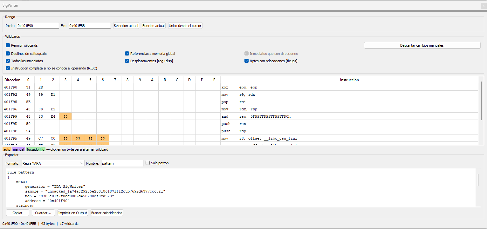

# IDA SigWriter

Plugin para IDA Pro que genera patrones de código a partir de la selección del
usuario, con GUI acoplable, wildcards opcionales y exportación a varios formatos.

Hay dos versiones con la misma funcionalidad:

| Versión | IDA | Qt | Ubicación |
|---|---|---|---|
| 8.2 | IDA Pro 8.2 | PyQt5 | `idasigwriter_plugin.py` + `idasigwriter/` |
| 9.3+ | IDA Pro 9.3 en adelante | PySide6 (Qt 6) | `ida93/SigWriter/` |

Para binarios **.NET** (bytecode CIL) hay un plugin aparte, también para 8.2 y
9.3+, en [`dotnet/`](dotnet/README.md). Cada plugin se activa solo en su tipo de
base de datos, así que pueden instalarse juntos.

## Screenhost



## Instalación

Directorio de plugins: `<IDA>/plugins` o el de usuario
(`%APPDATA%\Hex-Rays\IDA Pro\plugins` / `~/.idapro/plugins`).

**IDA 8.2** — copia:

```
idasigwriter_plugin.py
idasigwriter/           (la carpeta completa)
```

**IDA 9.3+** — copia la carpeta completa `ida93/SigWriter/` (la que contiene
`ida-plugin.json`):

```
plugins/SigWriter/ida-plugin.json
plugins/SigWriter/sigwriter_entry.py
plugins/SigWriter/sigwriter9/
```

Ninguna requiere dependencias externas (PyQt5 / PySide6 vienen con IDA). Si las
dos versiones de IDA comparten el directorio de plugins de usuario, puedes tener
ambas instaladas: la versión 8.2 se desactiva sola en IDA 9.x sin importar PyQt5
(así no aparece el diálogo del shim de PyQt5).

## Uso

1. Selecciona código en *IDA View* (o bytes en *Hex View*).
2. Click derecho → **Generar patron (SigWriter)...**, pulsa **Ctrl+Alt+S**,
   o usa *Edit → Plugins → SigWriter*.
   Si no hay selección se usa el elemento bajo el cursor.

La ventana tiene:

- **Rango**: inicio/fin editables (Enter para aplicar), *Selección actual*,
  *Función actual* y *Único desde el cursor* (agrega instrucciones hasta que el
  patrón coincida en un único lugar de la base de datos, máx. 256 bytes).
- **Wildcards**: interruptor general *Permitir wildcards* y reglas automáticas:
  destinos de saltos/calls, referencias a memoria global (incl. RIP-relative),
  inmediatos que son direcciones, todos los inmediatos, desplazamientos
  `[reg+disp]`, bytes con relocaciones (fixups) e instrucción completa cuando el
  procesador no informa dónde está el operando (ARM/MIPS, etc.).
- **Rejilla de bytes**: una fila por instrucción. *Click* en un byte alterna su
  wildcard manualmente (naranja = automático, violeta = manual, verde = forzado
  fijo). *Doble click* en la dirección salta a ella.
- **Exportar**:
  | Formato | Ejemplo |
  |---|---|
  | Standalone IDA | `E8 ? ? ? ? 48 8B 05 ? ? ? ?` |
  | Standalone x64dbg/CE | `E8 ?? ?? ?? ?? 48 8B 05 ?? ?? ?? ??` |
  | Standalone sin wildcards | `E8 10 20 30 40 48 8B 05 01 02 03 04` |
  | Array C/C++ | `const unsigned char pattern[] = {...};` + máscara `"x????xxx"`, bitmap y estilo `"\x48\x8B"` |
  | Regla YARA | `rule pattern { strings: $pattern = { E8 ?? ... } condition: $pattern }` |
  | Patrón YARA (checkbox *Solo patron*) | `{ E8 ?? ?? ?? ?? 48 8B 05 }` |
  | Blob binario | `.bin` (wildcards = 0x00) + `.mask` (0xFF fijo / 0x00 wildcard) si hay wildcards |

  Botones: *Copiar*, *Guardar...*, *Imprimir en Output* y *Buscar coincidencias*
  (lista hasta 100 direcciones en la ventana Output).

Notas:
- YARA (regla y *Solo patrón*): 28 bytes por fila y como máximo 20 filas por
  string (560 bytes). Si el patrón es más largo se divide en `$pattern_p1`,
  `$pattern_p2`, ... y la condición exige que cada pedazo esté en su offset
  exacto respecto de `$pattern_p1` (`$pattern_p2 at @pattern_p1[i] + 560`).
- YARA no admite hex strings que empiecen o terminen en wildcard, así que se
  recortan (se indica en `meta`). El nombre de la regla/variable se sanea.
- Si *Permitir wildcards* está desactivado, todos los formatos usan los bytes exactos.

## Estructura

```
idasigwriter_plugin.py    punto de entrada (PLUGIN_ENTRY, acción, menú contextual)
idasigwriter/pattern.py   modelo de patrón y exportadores (Python puro, sin IDA)
idasigwriter/ida_backend.py  lectura de bytes, decodificación, wildcards, búsqueda
idasigwriter/gui.py       GUI PyQt5 en un PluginForm
tests/test_pattern.py     tests de los exportadores: python3 -m unittest discover tests
```

### Versión 9.3+

```
ida93/SigWriter/ida-plugin.json          metadatos del plugin (formato IDA 9.x)
ida93/SigWriter/sigwriter_entry.py       PLUGIN_ENTRY con PLUGIN_MULTI + plugmod_t
ida93/SigWriter/sigwriter9/pattern.py    copia idéntica de idasigwriter/pattern.py
ida93/SigWriter/sigwriter9/ida_backend.py
ida93/SigWriter/sigwriter9/gui.py        GUI PySide6
```

`pattern.py` y `gui.py` están duplicados para que cada plugin sea autocontenido
(la GUI es genérica: el título y las opciones de wildcards las define cada
`ida_backend.py`). Los tests verifican que las copias sean idénticas, así que un
cambio debe aplicarse en todas (ver la tabla en `dotnet/README.md`).

## Diferencias 8.2 → 9.3+

Verificadas contra las fuentes oficiales de IDAPython 9.3.0 y 9.5.0
(github.com/HexRaysSA/ida-sdk):

| 8.2 | 9.3+ |
|---|---|
| PyQt5 (`sip`) | PySide6 (`shiboken6`); `TWidgetToQtPythonWidget` |
| `bin_search(start, end, image, mask, step, flags)` | eliminado → `ida_bytes.find_bytes(bytes, start, range_end=, mask=, flags=)` |
| `BWN_DUMP` | `BWN_HEXVIEW` |
| `plugin_t` + `PLUGIN_KEEP` | `PLUGIN_MULTI` + `plugmod_t` |
| plugin suelto | carpeta con `ida-plugin.json` |

## APIs de IDA 8.2 utilizadas

`ida_kernwin.PluginForm.FormToPyQtWidget`, `read_range_selection`,
`register_action` / `attach_action_to_popup` vía `UI_Hooks.finish_populating_widget_popup`,
`ida_ua.decode_insn` + `op_t.offb/offo`, `ida_bytes.bin_search(start, end, image, mask, step, flags)`,
`ida_fixup.fixup_data_t`.

## Licencia

IDASignWriter e IDASignWriterNet se distribuyen bajo licencia Apache 2.0. Para más información, revisar el archivo [LICENSE](./LICENSE)